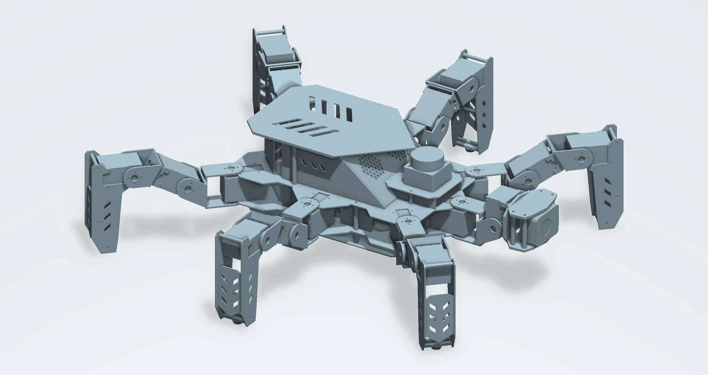

# Nira

ROS 2 repository for the Nira hexapod. This repository contains
Nira's hardware configuration, software, robot models and CAD.

[](nira_description/meshes/nira/assembly_complete.stl)

[Open the complete robot model (STL)](nira_description/meshes/nira/assembly_complete.stl)

## Getting started

Use Ubuntu 26.04 with ROS 2 Lyrical, C++23 and CMake 3.25 or newer.
Clone into `~/Workspace/colcon_nira/src/ros2_rumblex_nira`.

```bash
git clone https://github.com/SteinRobotics/ros2_rumblex_nira.git
```

Follow [setup](SETUP.md), [build and test](BUILD.md), and
[launch commands](LAUNCH.md). [Resource limits](nira_doc/BUILD_AND_TEST.md)
apply to builds, tests, simulation and CAD jobs. From the repository root, run
`./build_pc.sh` for the full workspace or `./build_robot.sh` for the headless hardware stack.

## Packages and hardware

Core packages are `nira_brain`, `nira_movement`, `nira_interfaces`,
`nira_utils`, `nira_communication`, `nira_hmi` and `nira_teleop`.
`nira_bringup` assembles the hardware stack; `nira_description`,
`nira_viz`, `nira_gazebo` and `nira_navigation` supply models, desktop visualization, simulation and navigation.

Nira uses Feetech servos, YDLIDAR 2D lidar, an OBSBOT camera and face perception.
See [sensors](SENSORS.md), [bill of materials](BOM_NIRA.md), and
[CAD](nira_cad/README.md).

## Interfaces and configuration

All owned packages and custom message types use the `nira_` prefix.

Launch files target Nira directly and have no `robot` selection argument.
Package-owned settings remain in `config/nira/`. Private speech models and credentials
are not committed; supply `nira_communication/models/nira.onnx` locally.

The workspace has its own [Python dependency manifest](requirements/README.md);
activate it with `source scripts/environment.sh`. CAD remains separate.

